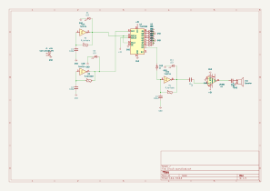
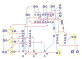

# Circuit cours — KiCad

Projet de circuit électronique alimenté en 5 V, avec un 74HC14, un registre à décalage 74HC595 et un amplificateur audio LM386. Le schéma comprend trois résistances variables, des LED et une sortie pour haut-parleur.

## Fichiers du projet

| Fichier | Contenu |
| --- | --- |
| [Circuit cours.kicad_pro](Circuit%20cours.kicad_pro) | Réglages du projet |
| [Circuit cours.kicad_sch](Circuit%20cours.kicad_sch) | Schéma électrique |
| [Circuit cours.kicad_pcb](Circuit%20cours.kicad_pcb) | Implantation et routage du PCB |
| [apercus/](apercus/) | Schéma et PCB au format SVG |

## Ouvrir avec KiCad

1. Télécharger le dépôt avec **Code → Download ZIP**, puis extraire l’archive, ou cloner le dépôt :

   ```sh
   git clone https://github.com/Romaindcrl/circuit-cours-kicad.git
   ```

2. Avec **KiCad 10**, ouvrir `Circuit cours.kicad_pro`.
3. Ouvrir le schéma ou l’éditeur de PCB depuis le gestionnaire de projet.

Les trois fichiers KiCad proviennent du projet fourni et sont conservés sans modification. Leur lecture et les exports ont été vérifiés avec KiCad 10.0.6 ; cette vérification ne constitue pas un test du montage physique.

## Aperçus

### Schéma électrique

[](apercus/schema.svg)

### Implantation et routage

Vue de dessus des couches de cuivre avant et arrière et de la sérigraphie avant.

[](apercus/pcb.svg)
